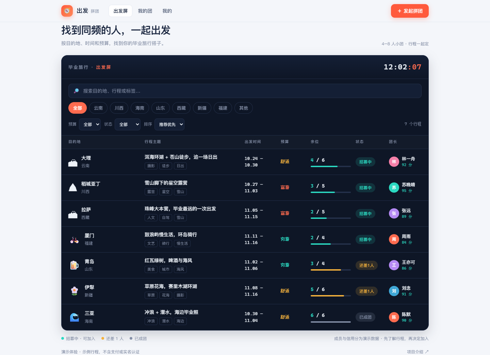
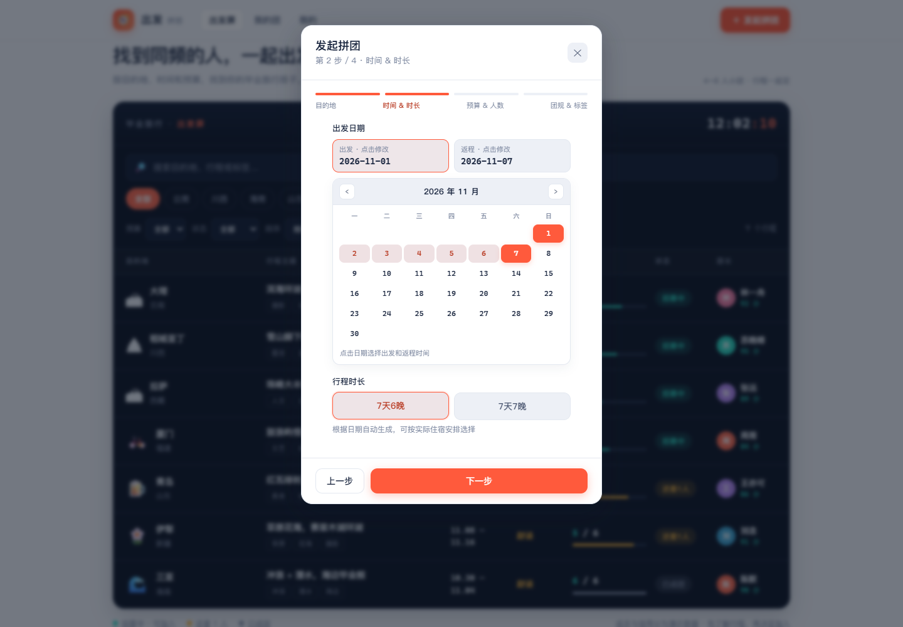

# 出发 · 拼团

找到同频的人，一起出发。一个面向毕业旅行的 4–8 人小团产品体验：按目的地、时间、预算和兴趣找到同行伙伴。

**[在线体验](https://ziyangao2-ux.github.io/graduation-trip/)** · [产品设计依据](docs/product-decisions.md)



## 可以体验什么

- **发现行程**：关键词搜索、地区与预算筛选、可加入状态、时间与最新发布排序；无结果一键恢复。
- **了解再加入**：查看日期、预算、团规、行程和成员余位；阻止满员与团长重复参团。
- **轻松发团**：地区与推荐目的地、紧凑日历、自动时长选项、预算人数、默认团规与分类兴趣标签。
- **管理参与**：确认后退出或取消，退出释放名额；自己发起与加入的行程集中展示。
- **分享行程**：复制详情链接，朋友可直接查看行程快照。
- **不中断填写**：自动保存未发布草稿，关闭或刷新后可以继续填写。
- **手机可用**：响应式布局、键盘访问、Esc 关闭、弹窗焦点约束。



## 体验路径

1. 搜索“摄影 徒步”，或选择地区、预算。
2. 点击行程查看详情并加入，在“我的团”查看结果。
3. 点击“发起拼团”，按四步选择目的地、日期、时长、人数和标签。
4. 发布后进入“我的团”，打开详情，点击分享。

## 当前版本的边界

这是可以在线分享和操作的前端演示版，**不是多人实时运营平台**。

- 示例行程、成员、信用分为演示数据，不代表实名认证或真实评价。
- 操作和草稿保存在当前浏览器 `localStorage`，换设备不会同步。
- 分享链接携带内容快照。加入、退出、取消仅改变操作方的本地数据；旧链接不会跟随更新。
- 不包含支付、账户系统、实时聊天、信用扣分、记账和后台审核。
- 示例日期随体验日期生成；自己发布的日期固定不变。
- 分享链接包含行程和成员快照，请不要在演示内容中填写私密信息。

## 本地运行与部署

无需安装框架，直接打开 `index.html`，或启动静态服务：

```bash
python -m http.server 8000
```

访问 `http://localhost:8000/`。GitHub Pages 采用 `main` 分支根目录发布，推送更新后自动部署。`Settings → Pages` 查看地址，`Actions` 查看部署与检查状态。

## 项目结构

```text
index.html                 页面、样式、交互与示例数据
screenshots/               实际浏览器截图
docs/product-decisions.md  竞品参考与产品取舍
scripts/check.mjs          无依赖静态检查
.github/workflows/check.yml 自动检查
CHANGELOG.md               更新记录
```

## 检查与下一步

安装 Node.js 后运行 `node scripts/check.mjs`。提交自动检查脚本语法、重复元素 ID 和固定 DOM 绑定目标。本次还使用 Playwright + Chrome 验收桌面 1440px 和手机 390px 的搜索、发布、参团、退出、分享接收与存储恢复。

正式多人使用需要账户、共享数据库、服务端人数与权限控制、沟通通知、内容管理和有实际依据的履约评价。当前版本适合产品展示、作品集和体验反馈。
